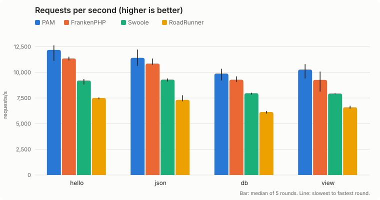
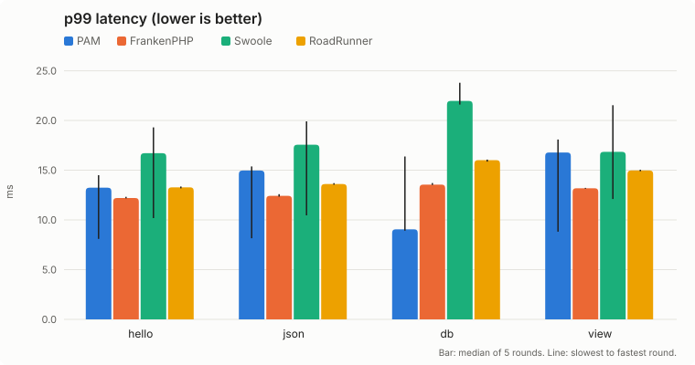

# Laravel Octane server benchmark

A reproducible comparison of the four Laravel Octane servers (PAM, FrankenPHP,
Swoole and RoadRunner) serving **the same Laravel application**, plus the
evidence behind the proposal to add PAM to Octane
([push-in/octane, branch `2.x-pam`](https://github.com/push-in/octane/tree/2.x-pam)):

1. Octane's own test suite with the PAM integration.
2. Throughput and latency of the four servers.
3. Zero-loss reload under load.
4. Request timeout (504) and upload memory.

Every number below links to the raw output it comes from. They are valid only
relative to each other, on the machine described in
[`machine.json`](results/2026-11-10/machine.json). Please run it on your own
hardware.

## Results (2026-11-10)

### Octane's test suite

Octane `2.x` with the PAM integration, commit
[`ccc1980`](https://github.com/push-in/octane/commit/ccc1980df8c6b7346fc9b2e0e9e2b3b0d924f086),
PAM 2.2.14.

Octane's own GitHub Actions workflows on that commit are green: all 21 `tests`
jobs (PHP 8.2 to 8.5, Laravel 12 and 13, Swoole, Open Swoole and
RoadRunner/FrankenPHP) and `static analysis`
([tests run](https://github.com/push-in/octane/actions/runs/42835363646),
[static analysis run](https://github.com/push-in/octane/actions/runs/42835364745)).

| Run | Tests | Pass | Fail | Skipped |
|---|---:|---:|---:|---:|
| [On PAM's PHP 8.5.12](results/2026-11-10/octane-suite/upstream.txt) | 238 | 195 | 0 | 43 (Swoole-only: no `swoole` extension) |
| [Same suite, every request and response through `PamClient`](results/2026-11-10/octane-suite/pam-driver.txt) | 238 | 195 | 0 | 43 |
| [PHP 8.5.12 CLI with Swoole 6.2.3](results/2026-11-10/octane-suite/php85-cli-swoole.txt) | 238 | 238 | 0 | 0 |

In the second run, [`PamFakeClient`](readiness/octane-suite/adapter/PamFakeClient.php)
replaces Octane's `FakeClient`: each of the 112 request/response exchanges of
the suite also goes through `Laravel\Octane\Pam\PamClient`, and the status,
body and cookies it writes are compared with what Laravel produced:
[0 mismatches](results/2026-11-10/octane-suite/pam-crosscheck.json).
Per-test results: [summary.md](results/2026-11-10/octane-suite/summary.md).

### Throughput and latency





Median of 5 rounds; in parentheses, the slowest and the fastest round
([results.md](results/2026-11-10/results.md), [bench.csv](results/2026-11-10/bench.csv),
[raw `wrk` output](results/2026-11-10/raw)).

Requests per second:

| Endpoint | PAM | FrankenPHP | Swoole | RoadRunner |
|---|---:|---:|---:|---:|
| hello | 12,187 (11,121 to 12,627) | 11,352 (11,165 to 11,526) | 9,200 (8,829 to 9,353) | 7,498 (7,373 to 7,552) |
| json | 11,409 (10,634 to 12,219) | 10,854 (10,730 to 11,345) | 9,292 (9,105 to 9,403) | 7,319 (7,180 to 7,766) |
| db | 9,880 (9,205 to 10,352) | 9,285 (9,056 to 9,606) | 7,966 (7,833 to 8,018) | 6,139 (5,980 to 6,237) |
| view | 10,271 (9,409 to 10,800) | 9,263 (8,113 to 10,066) | 7,938 (7,865 to 7,958) | 6,602 (6,459 to 6,744) |

Latency p50 / p99 in ms (p99 range in parentheses):

| Endpoint | PAM | FrankenPHP | Swoole | RoadRunner |
|---|---:|---:|---:|---:|
| hello | 5.19 / 11.37 (6.67 to 12.70) | 5.48 / 10.24 (10.04 to 10.80) | 6.62 / 14.88 (7.66 to 16.79) | 8.41 / 11.67 (10.97 to 11.97) |
| json | 5.36 / 12.26 (6.82 to 13.01) | 5.76 / 10.42 (10.03 to 10.53) | 7.06 / 8.32 (7.52 to 14.49) | 8.64 / 11.95 (11.42 to 12.33) |
| db | 6.32 / 8.88 (7.60 to 15.01) | 6.77 / 11.47 (11.13 to 11.77) | 8.08 / 9.17 (8.74 to 12.71) | 10.27 / 14.11 (13.31 to 14.39) |
| view | 6.01 / 13.12 (7.32 to 14.65) | 6.76 / 11.36 (10.50 to 15.60) | 8.11 / 8.69 (8.63 to 9.14) | 9.53 / 12.93 (12.51 to 13.52) |

| Server | Errors (all runs) | Container memory after the run, median (MiB) | Container peak (MiB) |
|---|---:|---:|---:|
| PAM | 0 | 453 | 515 |
| FrankenPHP | 0 | 482 | 564 |
| Swoole | 0 | 481 | 517 |
| RoadRunner | 0 | 712 | 752 |

Reading these numbers:

- PAM has the highest median throughput on every endpoint: 5.1 % (json) to
  10.9 % (view) above FrankenPHP, 23 to 33 % above Swoole and 56 to 63 % above
  RoadRunner.
- FrankenPHP has a lower and steadier p99 than PAM on `hello`, `json` and
  `view`; PAM's p99 varies more between rounds (for example 6.67 to 12.70 ms on
  `hello`, against 10.04 to 10.80 ms for FrankenPHP). Swoole has the lowest
  median p99 on `json` and `view`.
- Memory is the cgroup's `memory.current` / `memory.peak` and includes the page cache.

### Zero-loss reload

PAM 2.2.14, `octane:start --server=pam --workers=4 --max-requests=2000`,
`wrk -t4 -c64 -d60s` on `/_r/hello`, and `octane:reload --server=pam` every 4
seconds (12 or 13 reloads per run, none failed), in the PAM container's own
network namespace ([zero-loss.csv](results/2026-11-10/zero-loss/zero-loss.csv)).

| `net.ipv4.tcp_migrate_req` | Connections | Requests | Failed |
|---|---|---:|---:|
| 1 (recommended) | keep-alive | [386,034](results/2026-11-10/zero-loss/migrate-1-keep-alive.txt) | 0 |
| 1 (recommended) | new connection per request | [341,069](results/2026-11-10/zero-loss/migrate-1-close.txt) | 1 (socket write error) |
| 0 (kernel default) | keep-alive | [374,555](results/2026-11-10/zero-loss/migrate-0-keep-alive.txt) | 0 |
| 0 (kernel default) | new connection per request | [398,866](results/2026-11-10/zero-loss/migrate-0-close.txt) | 3 (socket write errors) |

Two more runs of each version on the same machine (failed requests, in the
table's order): PAM 2.2.14 `0 / 0 / 0 / 1` and `0 / 0 / 1 / 2`, PAM 2.2.13
`0 / 0 / 0 / 2` and `0 / 0 / 0 / 3`. A failure here is a single socket error
out of 300k to 420k requests; with `tcp_migrate_req=1` the new-connection case
lost 1 request in 1 of the 3 PAM 2.2.14 runs and none in the PAM 2.2.13 runs.

PAM reloads make-before-break: the new workers boot before the old ones drain.
Workers share the port with `SO_REUSEPORT`; with the kernel default, Linux
resets a connection whose handshake completes on a listener in the instant it
closes. `tcp_migrate_req=1` (Linux 5.14+) moves it to another listener instead.

### Request timeout and uploads

[behavior.txt](results/2026-11-10/behavior/behavior.txt), PAM 2.2.14 container,
2 workers, PHP `memory_limit=128M`:

- A handler sleeping 6 s with `octane.max_execution_time=2` gets
  `504 Gateway Timeout` after 2.10 s; the worker is replaced and the next 20
  requests return 200.
- `response()->send()`, which sends a raw `HTTP/1.1 200 OK` status line, returns
  200 on every request (PAM 2.2.13 answered 500 on PHP 8.5).
- A 100 MB upload whose handler is cut by the 2 s timeout: 504 after 2.14 s,
  no temporary file left behind (PAM 2.2.13 left it when the worker exited).
- A 100 MB and a 1 GB multipart upload: SHA-256 verified before and after
  `UploadedFile::move()`, PHP peak memory 14 MiB, worker peak RSS 65 and 68 MiB,
  no temporary file left behind. PAM streams multipart bodies to
  `upload_tmp_dir` and enforces `upload_max_filesize` / `post_max_size`.

## Method

- **Same app.** `laravel/laravel` with Laravel 13.40.0, Octane from
  `push-in/octane` at a fixed commit (also used for FrankenPHP, Swoole and
  RoadRunner), the routes in [`app/routes/bench.php`](app/routes/bench.php):
  `hello` (string), `json`, `db` (one SQLite row by random primary key out of
  100), `view` (Blade, 20 items). `APP_ENV=production`, `APP_DEBUG=false`,
  `artisan optimize`, the routes without the web middleware group.
- **Same start command.** Every server is started with
  `artisan octane:start --server=<server> --workers=8 --max-requests=10000000`
  ([`scripts/bench.sh`](scripts/bench.sh)); Swoole adds `--task-workers=1`.
- **Same PHP.** PHP 8.5.12 everywhere with [`docker/bench.ini`](docker/bench.ini):
  OPcache with JIT `tracing`, 128 MiB JIT buffer, no timestamp validation,
  `memory_limit=512M`.
- **Pinned versions.** [`versions.env`](versions.env): PAM 2.2.14 (official
  release, checksum verified by its installer; the throughput rounds and
  every result on this page uses 2.2.14), FrankenPHP 1.13.5 (static
  binary), `php:8.5.12-cli-bookworm` with Swoole 6.2.3 and RoadRunner
  2025.1.15, Composer 2.9.3. Dockerfiles in [`docker/`](docker).
- **Pinned CPUs.** The server container runs on CPUs 0-7 (four performance
  cores with SMT), `wrk -t4 -c64` on CPUs 8-11 (two other performance cores),
  `--network host`, one server at a time.
- **Rounds.** 5 rounds; each round runs every server, the order rotating per
  round. For each endpoint: 5 s warmup, then 15 s measured with `--latency`.
- **Machine.** Intel Core Ultra 9 185H laptop, 30 GiB RAM, Linux 7.0.11,
  Docker 28.1.1, CPU governor `performance`
  ([`machine.json`](results/2026-11-10/machine.json) records it at the start
  and the end of the run). The run started only after the 1-minute load
  average stayed below 2 for 5 minutes; [`load.csv`](results/2026-11-10/load.csv)
  has the load before each server run (about 10 to 12 during the run is the
  benchmark itself: 8 workers plus 4 `wrk` threads).

## Run it

Requirements: Linux, Docker, `wrk`, `taskset`, Python 3, bash. Root is not
required; for stable numbers set the CPU governor to `performance` first.

```bash
./run.sh                                   # images, app, machine.json, bench, zero-loss, behavior
./run.sh bench                             # one stage
ROUNDS=3 DURATION=30s ./run.sh bench       # any value of versions.env can be overridden
bash readiness/octane-suite/run.sh         # Octane's suite through PamClient (needs pam on PATH)
```

Results are written to `results/<date>/`. Adjust `SERVER_CPUS`, `LOAD_CPUS` and
`WORKERS` to your CPU topology.

## Related

- Octane integration: [push-in/octane `2.x-pam`](https://github.com/push-in/octane/tree/2.x-pam)
  ([diff against laravel/octane `2.x`](https://github.com/laravel/octane/compare/2.x...push-in:octane:2.x-pam))
- Docs: [push-in/docs `13.x-pam`](https://github.com/laravel/docs/compare/13.x...push-in:docs:13.x-pam)
- PAM: [push-in/pam](https://github.com/push-in/pam). Composer bridge for
  current Octane releases: [pushinbr/pam-octane](https://github.com/push-in/pam-octane).

## License

MIT
