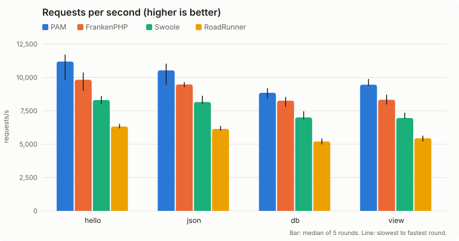
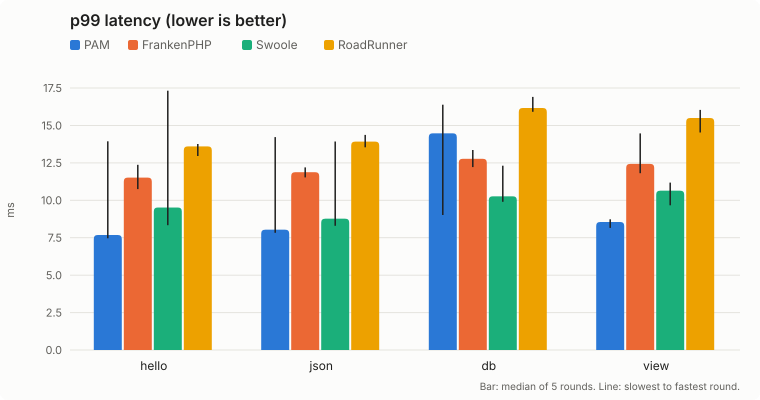

# Laravel Octane server benchmark

A reproducible comparison of the four Laravel Octane servers (PAM, FrankenPHP,
Swoole and RoadRunner) serving **the same Laravel application**, plus the
evidence behind the proposal to add PAM to Octane
([push-in/octane, branch `2.x-pam`](https://github.com/push-in/octane/tree/2.x-pam)):

1. Octane's own test suite with the PAM integration.
2. Throughput and latency of the four servers.
3. PAM's post-boot zygote: worker spawn, reload time and memory, with the
   memory of the other servers.
4. PAM's edge page cache on a cached page.
5. Zero-loss reload and recycling under load.
6. Request timeout (504) and upload memory.

Every number below links to the raw output it comes from. They are valid only
relative to each other, on the machine described in
[`machine.json`](results/2026-11-11/machine.json). Please run it on your own
hardware.

## Results (2026-11-11)

### Octane's test suite

Octane `2.x` with the PAM integration, commit
[`6d141b4`](https://github.com/push-in/octane/commit/6d141b4324f8f4b09fd2c766e862a634836bac15)
(requires PAM 2.2.15), PAM 2.2.15.

Octane's own GitHub Actions workflows on that commit are green: all 21 `tests`
jobs (PHP 8.2 to 8.5, Laravel 12 and 13, Swoole, Open Swoole and
RoadRunner/FrankenPHP) and `static analysis`
([tests run](https://github.com/push-in/octane/actions/runs/42965915249),
[static analysis run](https://github.com/push-in/octane/actions/runs/42965915642)).

| Run | Tests | Pass | Fail | Skipped |
|---|---:|---:|---:|---:|
| [On PAM's PHP 8.5.12](results/2026-11-11/octane-suite/upstream.txt) | 238 | 195 | 0 | 43 (Swoole-only: no `swoole` extension) |
| [Same suite, every request and response through `PamClient`](results/2026-11-11/octane-suite/pam-driver.txt) | 238 | 195 | 0 | 43 |
| [PHP 8.5.12 CLI with Swoole 6.2.3](results/2026-11-10/octane-suite/php85-cli-swoole.txt) (previous commit `ccc1980`; `6d141b4` only changes the required PAM version) | 238 | 238 | 0 | 0 |

In the second run, [`PamFakeClient`](readiness/octane-suite/adapter/PamFakeClient.php)
replaces Octane's `FakeClient`: each of the 112 request/response exchanges of
the suite also goes through `Laravel\Octane\Pam\PamClient`, and the status,
body and cookies it writes are compared with what Laravel produced:
[0 mismatches](results/2026-11-11/octane-suite/pam-crosscheck.json).
Per-test results: [summary.md](results/2026-11-11/octane-suite/summary.md).

### Throughput and latency





Median of 5 rounds; in parentheses, the slowest and the fastest round
([results.md](results/2026-11-11/results.md), [bench.csv](results/2026-11-11/bench.csv),
[raw `wrk` output](results/2026-11-11/raw)).

Requests per second:

| Endpoint | PAM | FrankenPHP | Swoole | RoadRunner |
|---|---:|---:|---:|---:|
| hello | 11,191 (9,820 to 11,709) | 9,826 (8,990 to 10,373) | 8,310 (8,003 to 8,598) | 6,323 (6,182 to 6,521) |
| json | 10,530 (9,451 to 11,034) | 9,479 (9,268 to 9,657) | 8,161 (7,985 to 8,630) | 6,140 (6,014 to 6,368) |
| db | 8,854 (8,425 to 9,199) | 8,260 (7,799 to 8,546) | 7,003 (6,869 to 7,467) | 5,205 (4,985 to 5,417) |
| view | 9,456 (9,375 to 9,888) | 8,329 (7,971 to 8,710) | 6,963 (6,904 to 7,358) | 5,443 (5,201 to 5,634) |

Latency p50 / p99 in ms (p99 range in parentheses):

| Endpoint | PAM | FrankenPHP | Swoole | RoadRunner |
|---|---:|---:|---:|---:|
| hello | 5.67 / 7.68 (7.46 to 13.94) | 6.32 / 11.52 (10.75 to 12.37) | 7.59 / 9.52 (8.34 to 17.32) | 9.96 / 13.60 (12.96 to 13.76) |
| json | 5.81 / 8.04 (7.83 to 14.22) | 6.58 / 11.88 (11.53 to 12.20) | 7.76 / 8.77 (8.30 to 13.93) | 10.27 / 13.92 (13.54 to 14.37) |
| db | 6.93 / 14.48 (9.02 to 16.39) | 7.58 / 12.77 (12.22 to 13.36) | 9.17 / 10.27 (9.90 to 12.31) | 12.17 / 16.17 (15.91 to 16.91) |
| view | 6.67 / 8.55 (8.16 to 8.73) | 7.54 / 12.43 (11.81 to 14.47) | 9.24 / 10.64 (9.67 to 11.18) | 11.59 / 15.50 (14.53 to 16.04) |

| Server | Errors (all runs) | Container memory after the run, median (MiB) | Container peak (MiB) |
|---|---:|---:|---:|
| PAM | 0 | 462 | 488 |
| FrankenPHP | 0 | 474 | 540 |
| Swoole | 0 | 463 | 494 |
| RoadRunner | 0 | 719 | 748 |

Reading these numbers:

- PAM has the highest median throughput on every endpoint: 7.2 % (db) to
  13.9 % (hello) above FrankenPHP, 26 to 36 % above Swoole and 70 to 77 % above
  RoadRunner.
- FrankenPHP is steadier: its p99 stays within about 1.6 ms across rounds on
  every endpoint, while PAM's p99 varies more between rounds (7.46 to 13.94 ms
  on `hello`). On `db`, FrankenPHP's median p99 (12.77 ms) is lower than PAM's
  (14.48 ms), and Swoole has the lowest `db` p99 (10.27 ms). PAM's median p99
  is the lowest on `hello`, `json` and `view`.
- Memory is the cgroup's `memory.current` / `memory.peak` and includes the page cache.
- This run is noisier than the previous one: the machine never stayed idle for
  5 minutes within 3 hours (other workloads kept the 1-minute load average
  between 2 and 7), so the run started at a load of 4 and the load during the
  run was 12 to 17 instead of 10 to 12 ([load.csv](results/2026-11-11/load.csv)). Every
  server ran under the same conditions, the order rotating per round.

### Post-boot zygote

PAM 2.2.15 can fork workers from an application that already booted
(`PAM_PREFORK_BOOT=app`, the default for `artisan pam:octane`) instead of
booting Laravel in every worker (`engine`, the default for Octane's PAM driver
in this release). Spawn and reload times are measured on Octane's own PAM
worker (`bin/pam-worker.php`), started exactly as `octane:start --server=pam`
starts it plus an admin address to read readiness; memory with every server
started by `octane:start --workers=N` after a 10 s `wrk` warmup on `view`.
Median of 3 rounds ([pam-times.csv](results/2026-11-11/zygote/pam-times.csv),
[memory.csv](results/2026-11-11/zygote/memory.csv), [script](scripts/zygote.sh)).

| PAM, Octane worker | 8 workers, post-boot | 8 workers, pre-boot | 16 workers, post-boot | 16 workers, pre-boot |
|---|---:|---:|---:|---:|
| Worker spawn to ready, p50 | **2 ms** | 226 ms | **2 ms** | 233 ms |
| `SIGHUP` reload until every new worker is ready, p50 | **222 ms** | 285 ms | **242 ms** | 307 ms |
| Cold start until every worker is ready | 458 ms | 384 ms | 369 ms | 417 ms |

| Memory (sum of PSS of the container's processes, MiB) | 8 workers | 16 workers |
|---|---:|---:|
| PAM, post-boot zygote | **200** | **221** |
| PAM, pre-boot | 233 | 290 |
| FrankenPHP | 316 | 387 |
| Swoole (`--task-workers=1`) | 307 | 455 |
| RoadRunner | 594 | 1,029 |

A worker forked from the booted application (a new one, a recycled one after
`--max-requests` or a replacement) is serving in about 2 ms and shares the
booted memory copy-on-write; a reload boots the application once instead of
once per worker. Cold start is the same order in both modes (the zygote boots
the application once, then forks).

### Edge page cache

PAM 2.2.15 can serve whole pages from its Rust HTTP layer without entering
PHP. `/_r/view-cached` is the `view` page with `Cache-Control: public,
s-maxage=60`; with `PAM_RESPONSE_CACHE=true` PAM answers it from the cache.
The cache is enabled through the
[pushinbr/pam-octane](https://github.com/push-in/pam-octane) 1.3.0 bridge
(`pam artisan pam:octane`), installed in a copy of the same app; Octane's PAM
driver does not expose it. 8 workers, same CPUs and `wrk` settings, median of
5 rounds ([page-cache.csv](results/2026-11-11/page-cache/page-cache.csv),
[raw](results/2026-11-11/page-cache/raw), [script](scripts/page-cache.sh)).

| | Cache off | Cache on |
|---|---:|---:|
| `view` (rendered by PHP on every request) | 9,577 req/s, p99 8.56 ms | 9,622 req/s, p99 8.29 ms |
| `view-cached` | 9,174 req/s, p99 8.80 ms | **490,956 req/s** (450,804 to 507,882), p50 0.12 ms, p99 3.41 ms |

0 errors. The cache does not slow down the page it does not cache. A cached
page is served about 50 times faster than PHP renders it; at that rate the
4 `wrk` threads are likely the limit. None of the other servers has a built-in
equivalent; in front of them the same result needs a reverse-proxy cache.

### Zero-loss reload and recycling

PAM 2.2.15, `octane:start --server=pam --workers=4`, `wrk -t4 -c64 -d60s` on
`/_r/hello`, in the PAM container's own network namespace, with
`net.ipv4.tcp_migrate_req` at the kernel default (0) and at 1
([zero-loss.csv](results/2026-11-11/zero-loss/zero-loss.csv)):

- **reload**: `--max-requests=2000` and `octane:reload --server=pam` every 4 s
  (13 reloads per run, none failed);
- **recycle**: no reloads, `--max-requests=500`, so every worker is replaced
  every few hundred milliseconds.

| Scenario | `tcp_migrate_req` | Keep-alive: requests / failed | New connection per request: requests / failed |
|---|---|---|---|
| reload | 0 (kernel default) | [400,293](results/2026-11-11/zero-loss/reload-migrate-0-keep-alive.txt) / 0 | [390,663](results/2026-11-11/zero-loss/reload-migrate-0-close.txt) / 0 |
| reload | 1 | [393,283](results/2026-11-11/zero-loss/reload-migrate-1-keep-alive.txt) / 0 | [406,594](results/2026-11-11/zero-loss/reload-migrate-1-close.txt) / 0 |
| recycle | 0 (kernel default) | [418,889](results/2026-11-11/zero-loss/recycle-migrate-0-keep-alive.txt) / 0 | [485,024](results/2026-11-11/zero-loss/recycle-migrate-0-close.txt) / 0 |
| recycle | 1 | [412,376](results/2026-11-11/zero-loss/recycle-migrate-1-keep-alive.txt) / 0 | [472,602](results/2026-11-11/zero-loss/recycle-migrate-1-close.txt) / 0 |

PAM reloads and recycles make-before-break: the new workers boot before the
old ones drain. Since 2.2.15 the PAM master keeps every listening socket and a
replacement worker adopts the one its predecessor listened on, so a listener
with queued connections is never closed and `tcp_migrate_req` is not needed.
With PAM 2.2.14 the same reload runs lost up to 3 requests with
`tcp_migrate_req=0` and 1 with `tcp_migrate_req=1`
([2026-11-10 results](results/2026-11-10/zero-loss/zero-loss.csv)).

### Request timeout and uploads

[behavior.txt](results/2026-11-11/behavior/behavior.txt), PAM 2.2.15 container,
2 workers, PHP `memory_limit=128M`:

- A handler sleeping 6 s with `octane.max_execution_time=2` gets
  `504 Gateway Timeout` after 2.10 s; the worker is replaced and the next 20
  requests return 200.
- `response()->send()`, which sends a raw `HTTP/1.1 200 OK` status line, returns
  200 on every request.
- A 100 MB upload whose handler is cut by the 2 s timeout: 504 after 2.14 s,
  no temporary file left behind.
- A 100 MB and a 1 GB multipart upload: SHA-256 verified before and after
  `UploadedFile::move()`, PHP peak memory 12 and 14 MiB, worker peak RSS 64 and
  66 MiB, no temporary file left behind. PAM streams multipart bodies to
  `upload_tmp_dir` and enforces `upload_max_filesize` / `post_max_size`.

## Method

- **Same app.** `laravel/laravel` with Laravel 13.40.0, Octane from
  `push-in/octane` at a fixed commit (also used for FrankenPHP, Swoole and
  RoadRunner), the routes in [`app/routes/bench.php`](app/routes/bench.php):
  `hello` (string), `json`, `db` (one SQLite row by random primary key out of
  100), `view` (Blade, 20 items). `APP_ENV=production`, `APP_DEBUG=false`,
  `artisan optimize`, the routes without the web middleware group.
- **Same start command.** Every server is started with
  `artisan octane:start --server=<server> --workers=8 --max-requests=10000000`
  ([`scripts/bench.sh`](scripts/bench.sh)); Swoole adds `--task-workers=1`.
- **Same PHP.** PHP 8.5.12 everywhere with [`docker/bench.ini`](docker/bench.ini):
  OPcache with JIT `tracing`, 128 MiB JIT buffer, no timestamp validation,
  `memory_limit=512M`.
- **Pinned versions.** [`versions.env`](versions.env): PAM 2.2.15 (official
  release, checksum verified by its installer; every result on this page uses
  2.2.15), FrankenPHP 1.13.5 (static binary), `php:8.5.12-cli-bookworm` with
  Swoole 6.2.3 and RoadRunner 2025.1.15, Composer 2.9.3, pushinbr/pam-octane
  1.3.0 (page cache section only). Dockerfiles in [`docker/`](docker).
- **Pinned CPUs.** The server container runs on CPUs 0-7 (four performance
  cores with SMT), `wrk -t4 -c64` on CPUs 8-11 (two other performance cores),
  `--network host`, one server at a time.
- **Rounds.** 5 rounds; each round runs every server, the order rotating per
  round. For each endpoint: 5 s warmup, then 15 s measured with `--latency`.
- **Machine.** Intel Core Ultra 9 185H laptop, 30 GiB RAM, Linux 7.0.11,
  Docker 28.1.1, CPU governor `performance`
  ([`machine.json`](results/2026-11-11/machine.json) records it at the start
  and the end of the run). The run waits until the 1-minute load average stays
  below 2 for 5 minutes, for up to 3 hours; for this run that never happened
  (other workloads on the machine), so it started at a load of 4.
  [`load.csv`](results/2026-11-11/load.csv) has the load before each server run
  (about 10 to 12 is the benchmark itself: 8 workers plus 4 `wrk` threads; this
  run saw 12 to 17).

## Run it

Requirements: Linux, Docker, `wrk`, `taskset`, Python 3, bash. Root is not
required; for stable numbers set the CPU governor to `performance` first.

```bash
./run.sh                                   # images, app, machine.json, bench, zygote, page-cache, zero-loss, behavior
./run.sh bench                             # one stage
ROUNDS=3 DURATION=30s ./run.sh bench       # any value of versions.env can be overridden
bash readiness/octane-suite/run.sh         # Octane's suite through PamClient (needs pam on PATH)
```

Results are written to `results/<date>/`. Adjust `SERVER_CPUS`, `LOAD_CPUS` and
`WORKERS` to your CPU topology.

## Related

- Octane integration: [push-in/octane `2.x-pam`](https://github.com/push-in/octane/tree/2.x-pam)
  ([diff against laravel/octane `2.x`](https://github.com/laravel/octane/compare/2.x...push-in:octane:2.x-pam))
- Docs: [push-in/docs `13.x-pam`](https://github.com/laravel/docs/compare/13.x...push-in:docs:13.x-pam)
- PAM: [push-in/pam](https://github.com/push-in/pam). Composer bridge for
  current Octane releases: [pushinbr/pam-octane](https://github.com/push-in/pam-octane).

## License

MIT
